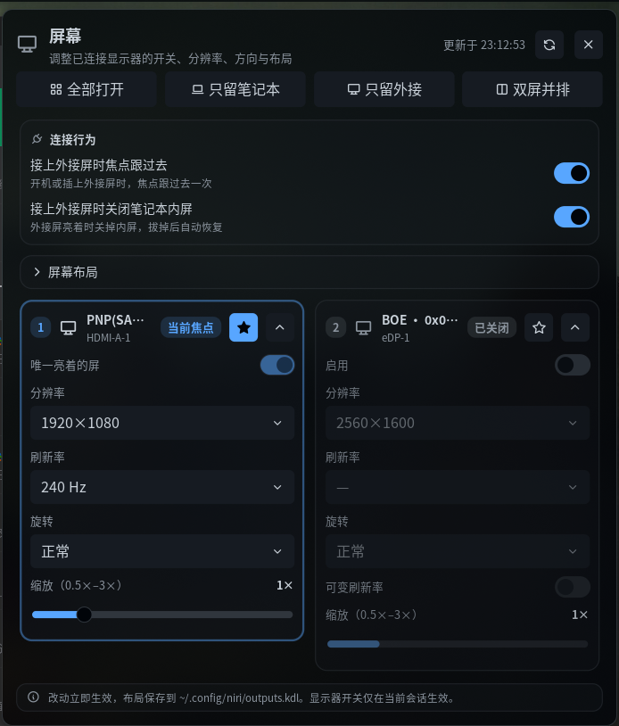
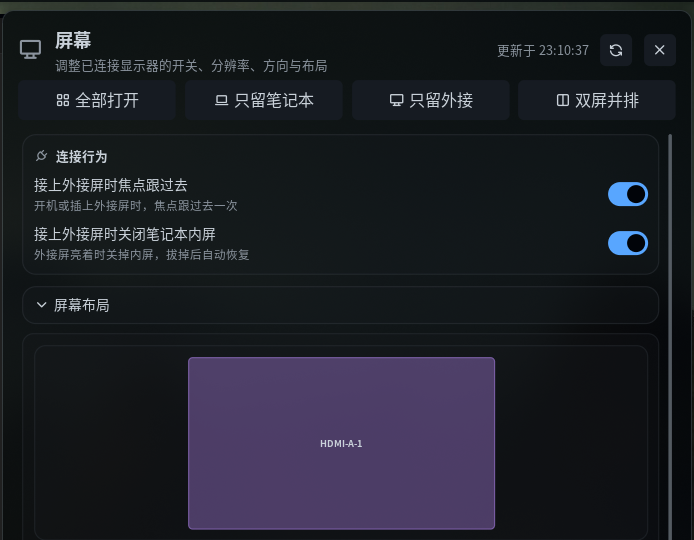

# Niri Displays

Noctalia 的 Niri 显示器管理插件。通过状态栏、浮动面板或控制中心调整输出，并将布局安全地写回 Niri 配置。

支持显示器开关、分辨率、刷新率、缩放、旋转与镜像、可变刷新率（VRR）、屏幕位置和启动主屏。界面提供中英文翻译。

> 基于 [raycursive/niri-displays](https://github.com/raycursive/niri-displays) 0.5.0 修改。

## 功能

- **完整的输出控制**：逐台显示器调整模式、0.5×–3× 缩放、方向、VRR 和位置；不可用的操作会自动禁用。
- **常用布局预设**：全部打开、只留笔记本、只留外接、双屏并排。切换前先启用目标输出，并检查执行结果。
- **可视化布局编辑**：预览各屏幕的相对位置，按方向吸附并微调偏移。尺寸变化后自动保持相邻屏幕的间距。
- **连接行为**：接入外接屏时自动转移焦点，或暂时关闭笔记本内屏；外接屏断开后恢复内屏。
- **分辨率缩放预设**：根据分辨率和可选端口自动应用缩放。
- **安全持久化**：布局先经 Niri 校验再写入，保留 `.bak` 备份，并保存已关闭或暂时断开输出的布局。
- **多种入口**：状态栏组件、显示器面板，以及控制中心的打开面板和循环布局快捷方式。

## 截图

### 显示器面板

连接行为、布局预设和各输出设置集中在一个面板中；显示器卡片可折叠。



### 屏幕布局

展开「屏幕布局」可查看相对位置并调整输出排列。



### 状态栏组件

显示器图标可放在状态栏中；也可显示当前焦点输出的端口和分辨率。


## 环境要求

| 组件 | 要求 |
| --- | --- |
| Noctalia | v5.4.0 或更新版本，插件 API 42 |
| Niri | 支持 `niri msg output`，可通过 `PATH` 找到 `niri` |
| 当前会话 | Noctalia 能读取 `NIRI_SOCKET` 并连接当前 Niri 会话 |
| 布局持久化 | 支持 KDL `include` 的 Niri 25.11 或更新版本 |

相关文档：[Noctalia 插件 API](https://docs.noctalia.dev/noctalia/v5.4.0/plugins/development/plugin-api/) · [Niri Include](https://niri-wm.github.io/niri/Configuration%3A-Include.html) · [Niri Outputs](https://niri-wm.github.io/niri/Configuration%3A-Outputs.html)

## 启用与配置

### 1. 启用插件

在 Noctalia 的「设置 → 插件」中启用 **Niri 显示器**，插件 ID 为 `xendr1a/niri-displays`。

按需添加入口：

- 在「设置 → 栏 → 组件」中添加 `bar`。
- 在控制中心快捷方式中添加 `shortcut` 以打开面板。
- 添加 `preset-cycle` 以循环切换「只留笔记本 → 只留外接 → 双屏并排」；不可用的预设会跳过。

也可以直接打开面板：

```sh
noctalia msg panel-toggle xendr1a/niri-displays:panel
```

### 2. 让布局在重启后恢复

插件默认写入 `~/.config/niri/outputs.kdl`。在 Niri 的 `config.kdl` 顶层加入：

```kdl
include "outputs.kdl" optional=true
```

- `optional=true` 需要 Niri 26.04 或更新版本，允许首次保存前文件尚不存在。
- 使用 Niri 25.11 时，先通过面板修改布局或发送 `save` 事件生成文件，再添加 `include "outputs.kdl"`。
- 相对路径以 `config.kdl` 所在目录为基准。自定义布局路径时，让插件的 `outputs_file` 与 `include` 指向同一文件；如果使用符号链接，`outputs_file` 应指向实际文件。
- 插件只替换自己生成的布局文件。已有手写文件不会被覆盖，请为插件指定专用路径。
- 如果已有 `output` 配置，请先备份，并避免同一输出在多处重复定义。

完成后运行：

```sh
niri validate
```

## 使用说明

### 面板与状态栏

- 左键点击状态栏图标打开面板；右键打开 Noctalia 内置「屏幕」页；滚轮调整亮度。
- 每张卡片显示厂商、型号、端口和当前焦点。点击箭头折叠卡片，点击星标设置启动主屏；若输出已启用，也会立即将焦点移过去。
- 分辨率、刷新率、旋转、VRR 和位置修改后立即生效，并由服务保存到布局文件。
- 缩放范围为 0.5×–3×，拖动结束后应用。
- 显示器开关只对当前会话生效，不会把 `off` 写入布局文件。最后一块仍启用的显示器不能通过开关关闭。

### 布局预设

| 预设 | 行为 |
| --- | --- |
| 全部打开 | 启用所有已连接输出。 |
| 只留笔记本 | 先启用内置屏，再关闭外接屏。 |
| 只留外接 | 先启用外接屏，再关闭内置屏。 |
| 双屏并排 | 将首块外接屏放在 `(0, 0)`，首块内置屏放在其右侧；位置按实际逻辑宽度计算。 |

内置屏通过 `eDP-*`、`LVDS-*` 或 `DSI-*` 端口名称识别。预设执行期间会暂时锁定其他显示器操作，并检查最终状态；失败时会在面板和 Noctalia 通知中显示错误。

### 屏幕布局

展开「屏幕布局」后，选择目标输出和方向，再调整偏移并点击「应用」。预览使用 Niri 报告的逻辑尺寸与实时位置。

当分辨率、缩放或旋转改变某块屏幕的逻辑尺寸时，插件会重新计算原本与其贴边或分离的相邻屏幕位置，保留原有间距；重叠布局不会被自动重排。

### 连接行为

连接策略保存在布局文件同目录的 `displays-policy.json`，重启后继续生效。

| 选项 | 默认值 | 行为 |
| --- | --- | --- |
| 接上外接屏时焦点跟过去 | 开 | 服务启动或外接屏接入时，将焦点从内置屏移到外接屏。 |
| 接上外接屏时关闭笔记本内屏 | 关 | 外接屏启用时关闭内屏；所有外接屏断开后自动恢复内屏。 |

策略在首次读取输出、外接屏集合变化或策略开关修改时执行。外接屏保持连接期间，手动切回焦点或重新打开内屏不会被反复覆盖。

## 插件设置

| 设置 | 类型 | 默认值 | 说明 |
| --- | --- | --- | --- |
| `outputs_file` | `string` | `~/.config/niri/outputs.kdl` | 自动生成的布局文件，应由 Niri `include` 引入。 |
| `scale_presets` | `string_list` | 空 | 按分辨率和可选端口自动应用缩放。 |
| `refresh_interval` | `int` | `30` | 兜底刷新间隔，范围 5–300 秒；输出事件通常会立即触发刷新。 |
| `glyph` | `glyph` | `device-desktop` | 状态栏图标。 |
| `show_resolution` | `bool` | 关 | 在图标旁显示当前焦点输出的端口和分辨率。 |

### 分辨率缩放预设

每行使用 `宽x高=缩放`，或使用 `端口:宽x高=缩放` 指定单个输出：

```text
3840x2160=1.5
2560x1440=1
DP-3:1920x1080=1.25
```

端口规则优先于通用规则；同一优先级下，最后一条有效匹配生效。插件会在服务启动、设置修改和检测到分辨率变化时应用规则，仅修改刷新率不会重新应用。

## 布局文件与备份

布局文件记录 `mode`、`scale`、`transform`、`position`、`variable-refresh-rate` 和 `focus-at-startup`：

- 不保存显示器的临时关闭状态，避免重连或重启后没有可用输出。
- 保留已关闭或已断开输出此前保存的配置。
- 未手动指定主屏时，优先选择外接屏作为启动焦点，并保留内置屏兜底。
- 写入前先用临时文件执行 `niri validate --config`，通过后再替换目标文件。
- 替换前将上一版保存为 `outputs.kdl.bak`；校验期间发生的外部修改不会被覆盖。

## IPC

向 `displays` 服务发送事件，无需打开面板：

```sh
# 刷新输出状态 / 将当前快照写入 Noctalia 日志
noctalia msg plugin xendr1a/niri-displays:displays all refresh
noctalia msg plugin xendr1a/niri-displays:displays all dump

# 保存布局 / 将已连接输出设为启动主屏
noctalia msg plugin xendr1a/niri-displays:displays all save
noctalia msg plugin xendr1a/niri-displays:displays all primary DP-1

# 应用布局预设
noctalia msg plugin xendr1a/niri-displays:displays all preset all
noctalia msg plugin xendr1a/niri-displays:displays all preset laptop
noctalia msg plugin xendr1a/niri-displays:displays all preset external
noctalia msg plugin xendr1a/niri-displays:displays all preset dual

# 查看连接策略 / 更新并立即应用连接策略
noctalia msg plugin xendr1a/niri-displays:displays all policy
noctalia msg plugin xendr1a/niri-displays:displays all policy '{"focus_external":true,"internal_off_with_external":true}'
```

将示例中的 `DP-1` 替换为实际端口。`primary` 设置启动主屏；若只需切换当前焦点，可运行 `niri msg action focus-monitor DP-1`。

## 验证与排错

```sh
# 检查插件清单与设置
noctalia plugins lint .

# 校验完整 Niri 配置（包括 include）
niri validate

# 查看输出与当前焦点
niri msg --json outputs
niri msg --json focused-output
```

布局写入、校验或策略执行失败时，查看 Noctalia 通知与日志。修改 `translations/*.json` 后，重新启用插件以重新载入译文。
